


I write standalone plugins for **RPG Maker MZ 1.8.1** and sell them on [itch.io](https://sekaigemplugins.itch.io). 
Right now I'm focused on lighting and menu systems.

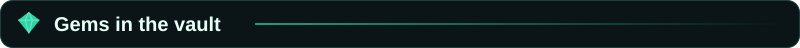

<a href="https://sekaigemplugins.itch.io">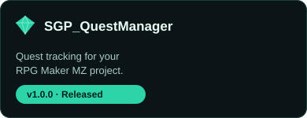</a>
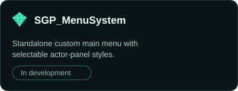
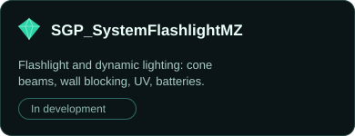
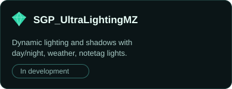

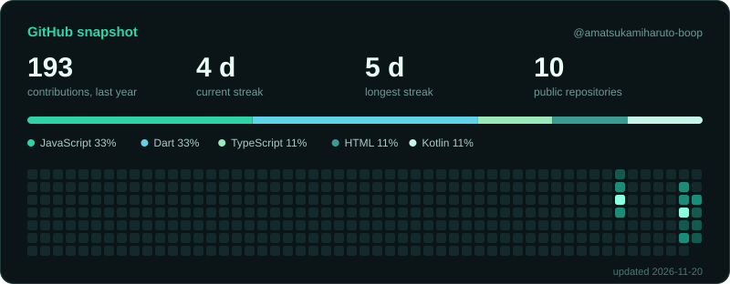

<a href="https://github.com/amatsukamiharuto-boop/Safodi">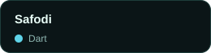</a>
<a href="https://github.com/amatsukamiharuto-boop/MasterSafety">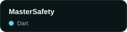</a>
<a href="https://github.com/amatsukamiharuto-boop/GPS-Location-Self">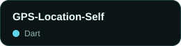</a>
<a href="https://github.com/amatsukamiharuto-boop/MyLockApp">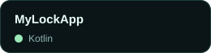</a>
<a href="https://github.com/amatsukamiharuto-boop/FastTravelWorldMap">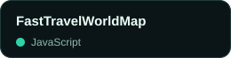</a>

&nbsp;

New gems are cut whenever the next idea sticks. Thanks for stopping by.

