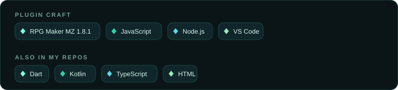



 

I write standalone plugins for **RPG Maker MZ 1.8.1** in JavaScript and sell them on [itch.io](https://sekaigemplugins.itch.io). 
Right now I'm focused on lighting and menu systems.

## Gems in the vault

| Plugin | What it does | Status |
| :-- | :-- | :-- |
| **SGP_QuestManager** | Quest tracking for your MZ project. | Released, v1.0.0 - [get it on itch.io](https://sekaigemplugins.itch.io) |
| **SGP_MenuSystem** | Standalone custom main menu with selectable actor-panel styles. | In development |
| **SGP_SystemFlashlightMZ** | Flashlight and dynamic lighting: radial and cone beams, wall blocking, UV light, batteries. | In development |
| **SGP_UltraLightingMZ** | Dynamic lighting and shadows with time of day, weather, and notetag-driven lights. | In development |

## The forge

## Field notes

## Side workshop

| Repository | Language |
| :-- | :-- |
| [Safodi](https://github.com/amatsukamiharuto-boop/Safodi) | Dart |
| [MasterSafety](https://github.com/amatsukamiharuto-boop/MasterSafety) | Dart |
| [GPS-Location-Self](https://github.com/amatsukamiharuto-boop/GPS-Location-Self) | Dart |
| [MyLockApp](https://github.com/amatsukamiharuto-boop/MyLockApp) | Kotlin |
| [FastTravelWorldMap](https://github.com/amatsukamiharuto-boop/FastTravelWorldMap) | JavaScript |
| [Website-Portofolio](https://github.com/amatsukamiharuto-boop/Website-Portofolio) | JavaScript |

## Find me

- Plugins: [sekaigemplugins.itch.io](https://sekaigemplugins.itch.io)
- Code: [github.com/amatsukamiharuto-boop](https://github.com/amatsukamiharuto-boop)

New gems are cut whenever the next idea sticks. Thanks for stopping by.

